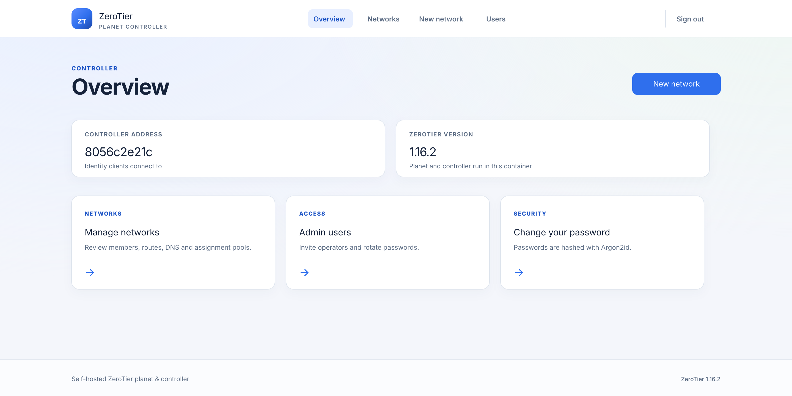
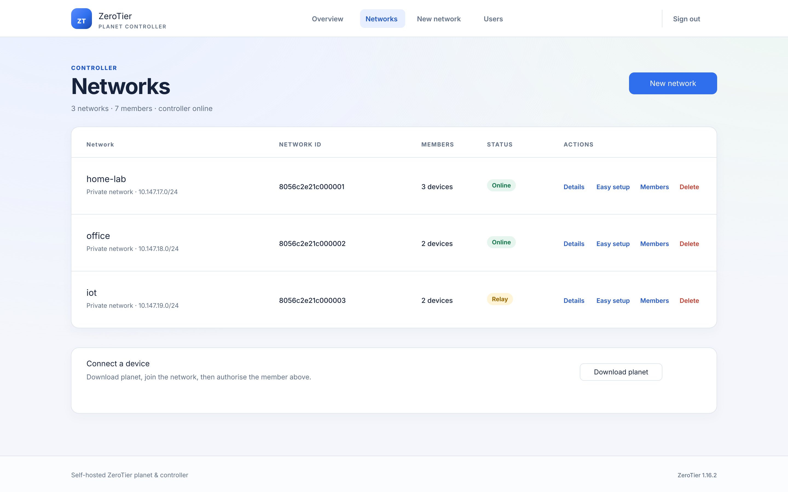
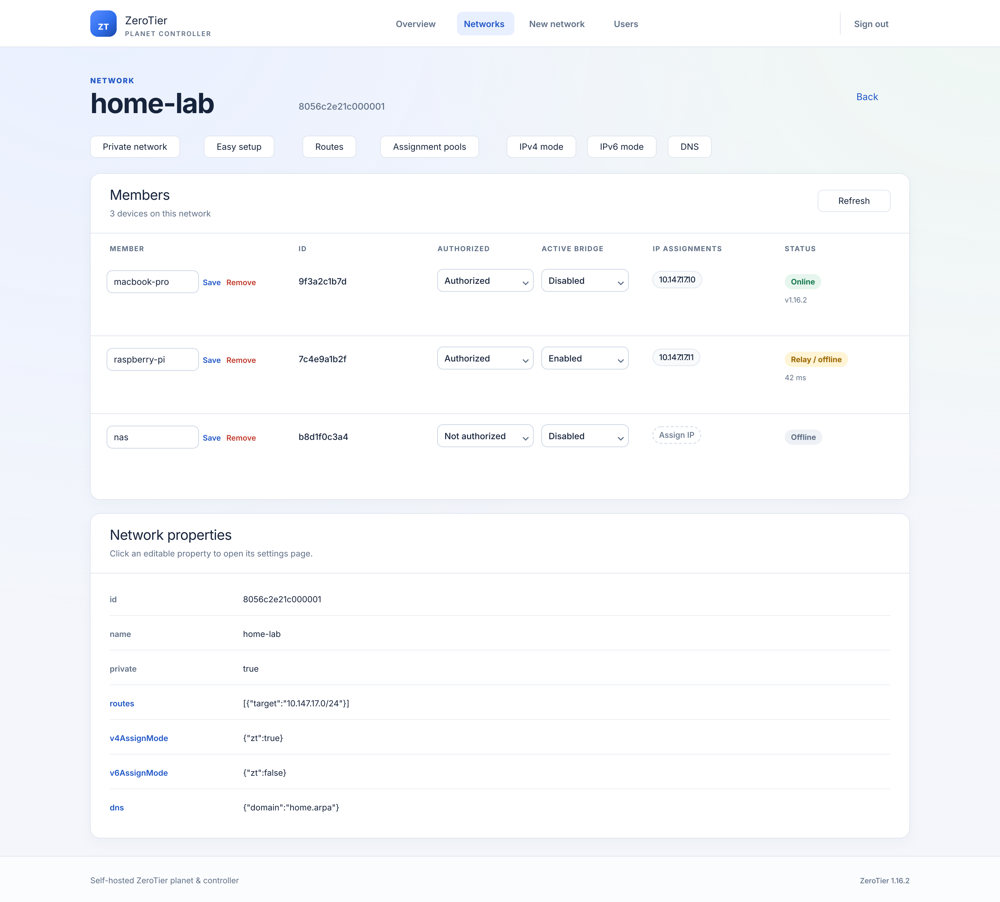
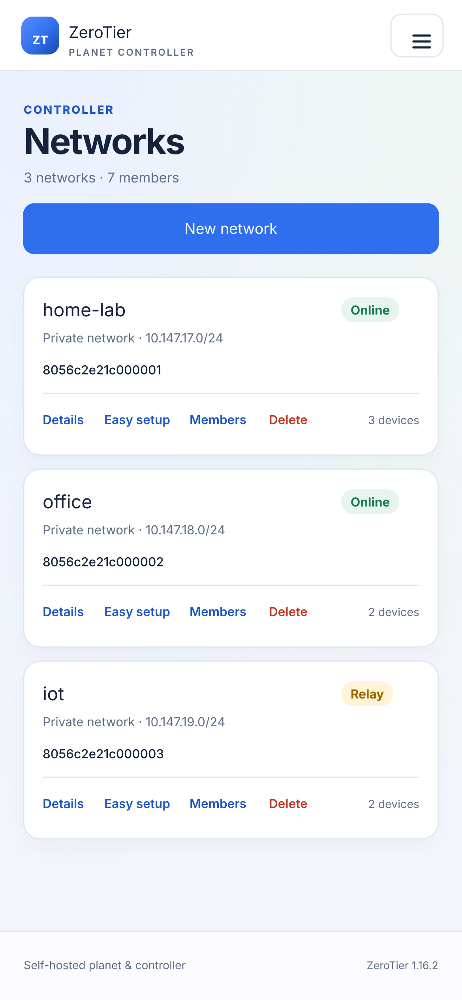
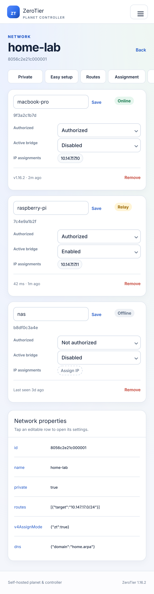

# docker-zerotier-planet 2.0 (hardened)

Run your own **ZeroTier planet** and **network controller (ztncui)** in Docker.
This is the **2.0** maintained fork of
[xubiaolin/docker-zerotier-planet](https://github.com/xubiaolin/docker-zerotier-planet),
upgraded to **ZeroTier One 1.16.2** (verified 2026-11-06: this is still the latest
upstream stable release) with fixes for the security issues reported against the
upstream project.

> **License warning (important)**
> Since ZeroTier 1.16 the controller lives in `nonfree/` and is covered by the
> *ZeroTier SOURCE-AVAILABLE LICENSE*: **personal, non-commercial use only**
> (plus student education/academia and a 30-day evaluation). This image is
> therefore built with `ZT_NONFREE=1`. Companies, government/military,
> non-profits/charities and paid services **must not** use the bundled
> controller. See [NOTICE](NOTICE) and `/usr/share/licenses/zerotier/`.

## Contents

- [Screenshots](#screenshots)
- [Changes from upstream](#changes-from-upstream)
- [Quick start](#quick-start): [script](#option-1-script) · [Compose](#option-2-compose) · [1Panel App Store](#option-3-1panel-app-store)
- [Configuration](#configuration) · [Data and backups](#data-and-backups) · [Migrating from upstream](#migrating-from-upstream)
- [Local build and tests](#local-build-and-tests) · [Building and releasing with GitHub Actions](#building-and-releasing-with-github-actions) · [Image registries](#image-registries)
- [Security model and limitations](#security-model-and-limitations) · [Troubleshooting](#troubleshooting) · [Changelog](CHANGELOG.md)

## Screenshots

The admin UI (ztncui 0.9.0) was rebuilt as a responsive card layout: Bootstrap 3
and jQuery are gone, the CSP only allows `'self'`, and member authorization /
bridging use explicit dropdowns.

| Controller overview | Networks |
| --- | --- |
|  |  |



On phones (≤720px) tables turn into cards with field labels and the navigation
collapses into a menu:

| Networks (phone) | Network detail (phone) |
| --- | --- |
|  |  |

## Changes from upstream

### Security (the five findings in issue #215)

| Finding | Fix |
| --- | --- |
| Hard-coded `admin/password` | A random 24-character password is generated on first boot into `config/admin-password` (0600). The UI forces a password change on first login and deletes the file afterwards |
| Path traversal in the file server | Only `planet` and `*.moon` are served; the resolved `realpath` must stay inside `dist/`; symlink escapes, `..` and encoded traversal are rejected |
| Download key in the URL query | `Authorization: Bearer` / `X-Api-Key` only by default; a 32-byte key persisted as 0600; the legacy `?key=` mode requires `ALLOW_QUERY_KEY=1` |
| Unpinned dependencies | ZeroTier pinned to `1.16.2` with commit verification; ztncui pinned to a commit; npm uses the committed lockfile and `npm ci --omit=dev --ignore-scripts` |
| Plaintext HTTP for UI and downloads | TLS by default (self-signed ECDSA P-256 with the server IP in the SAN), TLS 1.2+, HSTS; custom certificates can be mounted |

### Other upstream issues

- **#213**: `attic/world` was removed in 1.16 and the old `mkworld` no longer builds. The tool was rewritten against `node/World.hpp` + `ECC` and verifies the signature it produces.
- **#200**: port prompts in `deploy.sh` are no longer swallowed by command substitution, and ports are validated as `1-65535`.
- **#180**: data directories are created before `docker run`, so podman works too.
- **#196**: `/usr/sbin/zerotier-cli` and `zerotier-idtool` are available inside the image; the old `/bak` templates are gone.
- **#208**: `activeBridge`/`auth` are parsed as strict booleans; the string `"false"` is no longer truthy.
- **#185**: the default MemoryStore warning is replaced by a TTL-bounded store.
- **#163**: the entrypoint waits for ZeroTier's own authtoken instead of generating one, avoiding controller API 401s.
- **#216**: multi-arch build script and local Dockerfile; no dependency on the upstream Docker Hub image. Releases go to both GHCR and Docker Hub (see [Image registries](#image-registries)).
- **#157**: set `HTTPS_HOST=::` to listen on IPv6 as well (default `0.0.0.0`).
- **#205**: only `linux/amd64` and `linux/arm64` are built; armv7 is not supported.

### Additional hardening

- Services run as uid/gid 1000; the entrypoint only uses root briefly to fix volume ownership.
- No `set -x`: authtoken, controller token and download keys never appear in logs.
- ztncui: CSP, HSTS, SameSite/HttpOnly/Secure cookies, same-origin Origin/Referer checks, login throttling, open-redirect fix, prototype-chain username DoS fix, session fixation fix, and error pages without stack traces.
- Native `argon2` replaced by pure-WASM `hash-wasm` (no node-gyp) with Argon2id (64 MiB).
- ztncui frontend and dependency stack rewritten (0.9.0): Bootstrap 3, jQuery, got,
  ip-address and express-validator are gone. IP/CIDR checks use `node:net`,
  controller calls use Node 24's native `fetch`, and network creation uses the
  1.16 `POST /controller/network` API. `npm audit --omit=dev` reported zero
  advisories on 2026-11-06.
- The UI is a responsive card/table layout; on phones (≤720px) tables collapse into labelled cards, navigation collapses, toolbars scroll horizontally and touch targets are at least 42px. No inline scripts or styles
  (CSP allows `'self'` only). Member authorization/bridging uses explicit
  selects and keeps the strict boolean semantics from the #208 fix.
- Atomic 0600 password writes; existing passwords can only be changed by their owner; an admin can initialize a newly created user; the last admin cannot be deleted.
- Compose defaults to `read_only`, `no-new-privileges` and a `tmpfs` `/tmp`.
- `SECURITY.md`, a disclosure process, dependency lockfiles and regression tests.

### What 2.2.0 fixes and adds

- **`Bad request origin` on login is fixed.** The origin check now compares hostnames and
  trusts a proxy-forwarded `X-Forwarded-Host` (see
  [Reverse proxies and origin checks](#reverse-proxies-and-origin-checks)), so reverse
  proxies, port remaps and Origins without the default port no longer get rejected.
  Cross-site posts are still refused. Covered by the new `tests/origin.test.js`.
- **Simplified Chinese UI.** Every server-rendered admin page ships Chinese and English
  copy; the default is `zh-CN`, switchable from the header, stored in a cookie.
- **1Panel cron helper.** `scripts/1panel-scheduled-update.sh` can be scheduled as a
  1Panel cron job to refresh the app package and restart the installed instance.

### Deployment integrations (2.2.0)

- Ships a 1Panel app package (`1panel/apps/zerotier-planet`) plus an install script, so the
  panel can install, start/stop and upgrade it from a form; the image tag is pinned to the
  release version (e.g. `v2.2.0`) so the panel can detect updates.
- The app package, the `docker save` archives and the cron helper are published together in
  every Release, with `SHA256SUMS` covering all of them.

## Quick start

Pick one of the three ways — they end up with the same image and the same data layout:

| Option | Best for | What it does |
| --- | --- | --- |
| [Script](#option-1-script) | a plain Linux host | asks for the public address and ports, creates the directories, builds or pulls the image, waits for the health check |
| [Compose](#option-2-compose) | an existing compose workflow | you write `.env` yourself, full control over every parameter |
| [1Panel App Store](#option-3-1panel-app-store) | you already run 1Panel | ships an app package, install from the panel's form, manage it visually |

### Requirements

- Docker 24+ / Docker Compose v2; `amd64` or `arm64`
- A Linux host with a public IPv4 address (port forwarding if behind NAT)
- Allow **UDP 9994**, **TCP 3443** (UI) and **TCP 3000** (planet download)
- ~512 MiB RAM and 1 GiB disk

### Option 1: script

```bash
git clone https://github.com/ban-sky/docker-zerotier-planet-2.0.git
cd docker-zerotier-planet-2.0
./deploy.sh
```

The script asks for the public address and ports, creates `data/`, builds the
image if it is missing, starts the container and waits for its health check. It
asks before replacing an existing container and never deletes the data
directory.

> **Do not want to compile on the server?** Download
> `docker-zerotier-planet-2.0-<version>-amd64.tar.gz` from the
> [Releases](https://github.com/ban-sky/docker-zerotier-planet-2.0/releases) page
> and `docker load` it, or pull
> `ghcr.io/ban-sky/docker-zerotier-planet-2.0:v2.2.0` directly.

### Option 2: Compose

```bash
git clone https://github.com/ban-sky/docker-zerotier-planet-2.0.git
cd docker-zerotier-planet-2.0
cat > .env <<'EOF'
IP_ADDR4=203.0.113.10
# IP_ADDR6=2001:db8::10
EOF
# build locally on first use
docker compose up -d --build
```

### Option 3: 1Panel App Store

The repository ships a 1Panel app package ([`1panel/apps/zerotier-planet`](1panel)),
so the panel can install it from a form instead of a shell session.

```bash
git clone https://github.com/ban-sky/docker-zerotier-planet-2.0.git
cd docker-zerotier-planet-2.0
sudo ./scripts/install-1panel-app.sh
```

No checkout? Use the Release asset instead:

```bash
sudo tar -xzf 1panel-app-v2.2.0.tar.gz -C /opt/1panel/resource/apps/local
```

Then open 1Panel → **App Store → Update app list**, search for `ZeroTier Planet`
and install. The form asks for:

| Field | Meaning |
| --- | --- |
| Public IPv4 | the address advertised in the planet, **required** (use the mapped address behind NAT) |
| Public IPv6 | optional |
| Time zone | defaults to `Asia/Shanghai` |
| ZeroTier port | host UDP port, default 9994 |
| Admin UI port | host TCP port, default 3443 (HTTPS) |
| File server port | host TCP port, default 3000 (HTTPS, key required) |

Data lives in `data/` inside the 1Panel app directory (`config`, `dist`, `one`),
so upgrading the container keeps everything. First login password:

```bash
# open the app "Terminal" in the panel
cat /app/config/admin-password
# or look for it on the host (path depends on the 1Panel install location)
sudo find /opt/1panel/apps -maxdepth 6 -name admin-password
```

> The 1Panel **community edition** only scans `/opt/1panel/resource/apps/local/`;
> the **professional edition** "custom repository" can point at the `1panel/apps`
> directory of this repository as well. The image tag inside the package is pinned
> to `v2.2.0` (never `latest`) so the panel can detect version updates.

#### Cron job: follow new releases automatically

`scripts/1panel-scheduled-update.sh` is meant to be scheduled as a 1Panel
**Cron job → Shell script** entry; it refreshes the app package (and the installed
container) to the newest Release:

```bash
# see what it would do
sudo ./scripts/1panel-scheduled-update.sh --dry-run

# refresh the app package and the installed instance (default)
sudo ./scripts/1panel-scheduled-update.sh

# refresh the package only, leave the running container alone
sudo ./scripts/1panel-scheduled-update.sh --no-restart

# pin a specific version
sudo ./scripts/1panel-scheduled-update.sh --tag v2.2.0
```

In the panel: **Cron job → Create → Task type `Shell script`**, run it on whatever
schedule you like (e.g. daily at 04:00), with this command:

```bash
/path/to/docker-zerotier-planet-2.0/scripts/1panel-scheduled-update.sh --quiet
```

It resolves the latest tag on GitHub, compares it with
`.../apps/local/zerotier-planet/<version>`, downloads `1panel-app-<tag>.tar.gz`,
verifies `SHA256SUMS`, keeps a backup of the previous package (last five are kept),
then re-points the installed compose file at the new image tag and runs
`docker compose pull && up -d` — a failure exits non-zero and shows up in the cron
log. `--quiet` is cron-friendly (warnings and errors only); exporting
`GITHUB_TOKEN` raises the GitHub API rate limit. The script is also attached to
every Release, so a host without a git checkout can just download it.

### Interface language

The admin UI ships **Simplified Chinese** and English. The default is `zh-CN`
(it follows the browser `Accept-Language`, and `DEFAULT_LOCALE=en` changes the
default). The header switch stores the choice in a `lang` cookie; the switch is
plain `/lang/zh-CN` and `/lang/en` links, no JavaScript involved.

### First login

```bash
sudo cat data/config/admin-password
```

Open `https://<public-ip>:3443`, accept the self-signed certificate, and log in
as `admin` with that password. The UI immediately forces a password change; the
`admin-password` file is deleted once the new password is set.

### Distribute the planet file

The safest approach is to copy it from the host (no download key needed):

```bash
cp data/dist/planet ./planet
```

Or download it from the file server (key in `data/config/file_server.key`):

```bash
curl -fsS \
  -H "Authorization: Bearer $(sudo cat data/config/file_server.key)" \
  https://<public-ip>:3000/planet -o planet
```

Place `planet` in the client's data directory and restart ZeroTier:

| OS | Path |
| --- | --- |
| Linux | `/var/lib/zerotier-one/planet` |
| Windows | `C:\ProgramData\ZeroTier\One\planet` |
| macOS | `/Library/Application Support/ZeroTier/One/planet` |
| Android/iOS | import it with a client that supports custom planets |

After the restart, `zerotier-cli listpeers` should show your planet instead of
the official one.

### Optional moon

`data/dist/` also contains `<moon-id>.moon`. Copy it into the client's
`moons.d/`, then:

```bash
zerotier-cli orbit <moon-id> <moon-id>
```

### Create and join a network

1. In ztncui open **Networks → Add network** and note the 16-digit network ID.
2. On the client run `zerotier-cli join <network-id>`.
3. Authorize the member in ztncui, then assign IPs/routes/rules as needed.
4. `zerotier-cli listnetworks` should report `OK PRIVATE`.

## Configuration

| Variable | Default | Description |
| --- | --- | --- |
| `IP_ADDR4` | auto-detected private IPv4 | **Set this to the public IPv4/hostname clients can reach**; written into moon/planet |
| `IP_ADDR6` | empty | Optional public IPv6 |
| `ZT_PORT` | `9994` | ZeroTier UDP port (fixed to 9994 inside the container) |
| `API_PORT` | `3443` | ztncui HTTPS port (fixed to 3443 inside) |
| `FILE_SERVER_PORT` | `3000` | planet download port (fixed to 3000 inside) |
| `TLS_ENABLED` | `1` | `0` disables TLS (**not recommended**; credentials travel in clear text) |
| `TLS_CERT` / `TLS_KEY` | self-signed | In-container paths to custom certificate/key |
| `FILE_KEY` | generated | At least 32 characters; overrides the stored download key |
| `ALLOW_QUERY_KEY` | `0` | Re-enable the legacy `?key=` download mode |
| `REGENERATE_PLANET` | `1` | Rebuild the planet on every start (identity unchanged) |
| `APP_UID` / `APP_GID` | `1000` | uid/gid used by the services |
| `HTTPS_HOST` | `0.0.0.0` | Set to `::` to listen on IPv6 as well |
| `DEFAULT_LOCALE` | `zh-CN` | Default UI language: `zh-CN` or `en` |
| `ALLOWED_ORIGINS` | empty | Extra allowed form origins, comma separated, e.g. `https://zt.example.com` |
| `TRUST_PROXY` | empty | Number of trusted proxies, e.g. `1`; trusts `X-Forwarded-For` and `X-Forwarded-Host` |

Publish ports with `docker run -p` or Compose; the in-container ports are fixed
so documentation, health checks and the UI stay consistent.

### Reverse proxies and origin checks

The admin UI accepts state-changing requests (`POST`/`PUT`/`PATCH`/`DELETE`) only
from the same origin. The check compares **hostnames** and automatically trusts a
proxy-forwarded host when the request comes from a loopback or private address
(the normal container / same-host proxy case), or when `TRUST_PROXY` is set. That
is why Nginx, Caddy or the 1Panel site proxy no longer trigger
`Bad request origin` when they rewrite `Host`. If your public name never reaches
the container (a CDN in front, for example), list it in `ALLOWED_ORIGINS`.

### Custom certificates

```bash
mkdir -p data/config/tls
cp fullchain.pem data/config/tls/fullchain.pem
cp privkey.pem   data/config/tls/privkey.pem
docker compose restart
```

The certificate must include `IP:<public-ip>` or the hostname clients use in its
SAN. Behind Nginx/Caddy, expose only the proxy and set `TRUST_PROXY=1`; you can
then bind `API_PORT`/`FILE_SERVER_PORT` to `127.0.0.1`.

### Data and backups

| Path | Contents |
| --- | --- |
| `data/one/` | ZeroTier identity, controller database, authtoken, moon |
| `data/config/` | ztncui password database, session secret, TLS keys, download key, bootstrap password |
| `data/dist/` | Publicly distributable `planet` and `.moon` files |

**`data/one/identity.secret` is the root identity of the planet.** If it is
lost, every client must switch to a new planet. Back up `data/one/` and
`data/config/` offline and encrypted. Image upgrades never modify these volumes.

## Migrating from upstream

If you are running `xubiaolin/docker-zerotier-planet`, the migration script upgrades
the existing deployment in place. It preserves the ZeroTier identity, controller
database, authtoken, planet/moon files and ztncui accounts. The old container is
removed only after the new one is healthy; a failed start restores the backup and
restarts the old container.

```bash
# inspect the plan first (no changes)
sudo ./scripts/migrate-from-upstream.sh --dry-run

# migrate (default container: myztplanet; data root is derived from its mounts)
sudo ./scripts/migrate-from-upstream.sh

# custom container name or data root
sudo ./scripts/migrate-from-upstream.sh --name myztplanet --data /path/to/data/zerotier

# old data under /root, new checkout under /opt, and data should move to /opt
sudo ./scripts/migrate-from-upstream.sh \
  --data /root/docker-zerotier-planet/data/zerotier \
  --target-data /opt/docker-zerotier-planet/data/zerotier
```

`--target-data` copies the old `config`, `dist` and `one` directories to the new
root and points the new container at it. The old root is left untouched; remove
it manually after verifying the new deployment. The target must not exist or be
empty.

The script:
- backs up the whole data directory to `backups/upstream-migration-<time>.tar.gz`;
- reuses the old `one/` (identity, controller.d, moons.d, authtoken.secret);
- copies the old `ztncui/src/etc/passwd` to `config/ztncui-passwd`;
- migrates ztncui member display names (node-persist storage);
- builds the image from the current branch, starts a temporary container and swaps
  it into place after the health check;
- keeps the old `config/file_server.key` when it is long enough, and rebuilds planet.

After migration:
- the UI is HTTPS with a self-signed certificate; old `http://` links stop working;
- planet downloads use header authentication; legacy `?key=` is disabled by default;
- the planet ID is unchanged, but the file is rebuilt; clients should download it again;
- the old container definition is saved as `backups/*-container.json` for manual rollback.

The new deployment still needs only three volumes: `config`, `dist` and `one`.
The old `ztncui` directory is no longer mounted; mounting over `/app/ztncui` would
hide the immutable application and prevent security updates.

## Local build and tests

Builds use digest-pinned Debian bookworm-slim and Node.js 24 LTS slim base images.
When bumping a base image, update the ARGs at the top of `Dockerfile` and re-run
the tests.

apt defaults to the USTC Debian mirror (`APT_MIRROR=http://mirrors.ustc.edu.cn`) so
builds in mainland China do not stall on `deb.debian.org`. Override it for other
networks:

```bash
APT_MIRROR=http://deb.debian.org ./build.sh
```

Git clones go through `https://ghfast.top/https://github.com` by default and fall
back to `https://github.com`. The proxy is only a transport; ZeroTier and ztncui
are still verified against pinned commits. Outside China, or to use another proxy:

```bash
GH_MIRROR=https://github.com ./build.sh
# or
GH_MIRROR=https://gh-proxy.com/https://github.com ./build.sh
```

ZeroTier `1.16.2` has both a branch and an annotated tag with the same name. The
build fetches the tag explicitly and verifies the commit, so it never checks out
the branch tip by accident.

The build defaults to `BUILD_JOBS=1`, and ui-builder waits for zt-builder before
starting so small VPS instances do not run apt/npm and the C++ compile at the
same time. Add 2–4 GiB of swap when RAM is below 2 GiB; raise the job count only
when there is enough memory:

```bash
# default: one compile job, lowest memory
./build.sh

# more memory available
BUILD_JOBS=2 ./build.sh
```

A multi-arch build (`PUSH=1`) compiles once per platform (amd64 and arm64), so peak
memory is roughly twice that of a single-arch build. On a small host, build only
the native architecture, or build each platform on a separate machine.

```bash
# local single-architecture build
./build.sh

# multi-arch build and push (log in to the registry first)
PUSH=1 IMAGE=ghcr.io/ban-sky/docker-zerotier-planet-2.0:latest ./build.sh

# tests
cd patch/ztncui && npm ci --omit=dev --ignore-scripts
cd ../..
./tests/http-server.test.sh
node tests/ztncui-views.test.js
node tests/origin.test.js
```

`tests/http-server.test.sh` contains file-server security regression tests,
`tests/ztncui-views.test.js` compiles every Pug view, and `tests/origin.test.js`
covers the origin check (reverse proxies, port remaps, cross-site posts).

### Building and releasing with GitHub Actions

Two workflows ship with the repository (both under `.github/workflows/`, committed
normally — nothing has to be pasted into the web UI):

| Workflow | Trigger | What it does |
| --- | --- | --- |
| `image-build.yml` | push to `main`, changes to `Dockerfile`/`patch/`, or manual | builds the image and pushes it to GHCR (`latest`, `sha-<commit>`) |
| `release.yml` | push a `v*` tag, or a manual run with a version | builds, smoke-tests, packages a `docker save` archive and publishes a GitHub Release |

#### Publishing a version

```bash
git tag -a v2.2.0 -m "docker-zerotier-planet 2.0"
git push origin v2.2.0
```

The tag runs four jobs:

1. **prepare** — normalises the version string.
2. **build** — builds `linux/amd64` on a native runner; when `include_arm64` is
   selected it also builds `linux/arm64` on `ubuntu-24.04-arm` (native ARM, no
   emulation).
3. **smoke** — actually boots the amd64 image and asserts: the planet and moon are
   generated (upstream issue #213), the controller UI answers over HTTPS with the
   login form, the file server returns 401 without a key, the legacy `?key=`
   parameter stays disabled, path traversal returns 404, and the random admin
   password lives in a 0600 file without ever appearing in the container log.
4. **release** — writes `SHA256SUMS` and `SOURCE` (the exact upstream commits),
   packages the 1Panel app (`1panel-app-<version>.tar.gz`), creates the GitHub
   Release with the archives attached, and assembles a multi-arch manifest in GHCR.

Release assets:

```text
docker-zerotier-planet-2.0-v2.2.0-amd64.tar.gz    # gzipped docker save archive
docker-zerotier-planet-2.0-v2.2.0-arm64.tar.gz    # only when include_arm64 is set
1panel-app-v2.2.0.tar.gz                          # 1Panel app package
1panel-scheduled-update.sh                          # cron helper: update the app package
SHA256SUMS                                       # checksums for every archive
SOURCE                                           # upstream commits and build args
LOAD-amd64-v2.2.0.txt                            # load and run instructions
```

On a server, use the archive — no compiler and no registry login required:

```bash
docker load < docker-zerotier-planet-2.0-v2.2.0-amd64.tar.gz
docker images | grep docker-zerotier-planet-2.0
```

The archive restores the tag
`ghcr.io/ban-sky/docker-zerotier-planet-2.0:v2.2.0`, so the `image:` field in
`docker-compose.yml` can point straight at it.

### Image registries

Every release is published to both **GHCR** and **Docker Hub**. They hold the same
multi-arch manifest (`linux/amd64` + `linux/arm64`) and both are **public**, so
`docker pull` needs no login:

| Registry | Reference |
| --- | --- |
| GHCR (GitHub) | `ghcr.io/ban-sky/docker-zerotier-planet-2.0` |
| Docker Hub | `docker.io/lonelyx/docker-zerotier-planet-2.0` |

```bash
# GHCR
docker pull ghcr.io/ban-sky/docker-zerotier-planet-2.0:v2.2.0

# Docker Hub
docker pull lonelyx/docker-zerotier-planet-2.0:v2.2.0
```

Tag semantics (identical on both registries):

| Tag | Contents | Updated when |
| --- | --- | --- |
| `v2.2.0` | the multi-arch image of that release | a `v*` tag is pushed or Release is dispatched |
| `latest` | the most recent release | same |
| `sha-<commit>` | build of one `main` commit | push to `main` touching `Dockerfile` / `patch/**` |

Current `v2.2.0` manifest (identical on both registries):

```text
MediaType: application/vnd.oci.image.index.v1+json
Digest:    sha256:dd1a860079fc2403639442aae3a650704fd839de8ebe2a25998f76b37414cee8
  linux/amd64  -> sha256:397689b7e33e645562f1008e8cb7f768552bc156a2a226e44587e6dd08e2f9e0
  linux/arm64  -> sha256:eceb615b702fdbc0c90d9c06eaa236dbd6b8be89469eb9387b78a8496bab5690
```

> The GHCR package inherits the repository visibility (public here). If a fork is private
> the package is private too; then either make the package public (GitHub → Packages →
> Package settings → Visibility) or log in with a PAT that has `read:packages`:

```bash
echo "$CR_PAT" | docker login ghcr.io -u ban-sky --password-stdin
```

> Docker Hub rate-limits anonymous pulls (100 per 6 hours, 200 when authenticated).
> Run `docker login` on production hosts to avoid sharing a throttled IP.

#### How the Docker Hub mirror works

This repository already has the mirror enabled: both `image-build` and `release` carry a
step that copies the manifest with `docker buildx imagetools create` — **without
rebuilding** — so the Docker Hub image is byte-identical to GHCR and shares the same digest.

To enable it on a fork, three steps:

1. Create the repository `docker-zerotier-planet-2.0` on Docker Hub (no initialisation
   needed — the first push creates it);
2. Docker Hub → **Account settings → Security → New access token**, scope **Read & Write**;
3. Repository → **Settings → Secrets and variables → Actions**, add two secrets:
   - `DOCKERHUB_USERNAME` — your Docker Hub username (sets the image namespace)
   - `DOCKERHUB_TOKEN` — the access token from step 2 (**not** your password)

Without those secrets both mirror steps are `skipped` and only GHCR is used, so nothing
else breaks. The image name lives in one place per workflow
(`dst="docker.io/${DOCKERHUB_USERNAME}/docker-zerotier-planet-2.0"`).

Pull and deploy without compiling on the server (either registry, same image):

```bash
# GHCR
docker pull ghcr.io/ban-sky/docker-zerotier-planet-2.0:v2.2.0

sudo IMAGE=ghcr.io/ban-sky/docker-zerotier-planet-2.0:v2.2.0 \
  PULL=1 ./deploy.sh --pull --name myztplanet --data ./data/zerotier

# Docker Hub (useful when it is the faster registry for you)
sudo IMAGE=lonelyx/docker-zerotier-planet-2.0:v2.2.0 \
  PULL=1 ./deploy.sh --pull --name myztplanet --data ./data/zerotier
```

Migrating an old deployment directly from a workflow image:

```bash
sudo ./scripts/migrate-from-upstream.sh \
  --pull \
  --image ghcr.io/ban-sky/docker-zerotier-planet-2.0:v2.2.0 \
  --target-data /opt/docker-zerotier-planet/data/zerotier
```

The workflows run on GitHub-hosted runners; the server only loads or pulls the
image.

### Upgrading upstream versions

`scripts/upgrade-upstreams.sh` checks and updates the two upstream pins. It only
edits `ZT_VERSION`, `ZT_COMMIT` and `ZTNCUI_COMMIT` in `Dockerfile`; it does not
merge xubiaolin/docker-zerotier-planet (this fork has diverged) and does not commit:

```bash
# read-only check (default)
./scripts/upgrade-upstreams.sh

# update Dockerfile and run the local regression tests
./scripts/upgrade-upstreams.sh --apply

# only one upstream
./scripts/upgrade-upstreams.sh --apply --zerotier-only
./scripts/upgrade-upstreams.sh --apply --ztncui-only

# build after a successful update (requires docker)
./scripts/upgrade-upstreams.sh --apply --build
```

The script needs `curl`, `git` and `node` (`--build` additionally needs docker). Set `GITHUB_TOKEN` if the anonymous GitHub API rate limit is too low. After a
ZeroTier bump, read the release notes and re-check the controller API; after a
ztncui bump, review whether the `patch/ztncui` controller/view overlay still
applies. Version numbers and changelog text in README/SECURITY are updated
manually.

## Security model and limitations

- Single-node controller; there is no HA. The controller database is
  `data/one/controller.d`.
- Sessions live in memory; a container restart logs everyone out.
- A self-signed certificate provides encryption, not identity. Use a trusted
  certificate or a reverse proxy in production.
- Keep the UI on a trusted network; do not expose port 3443 to the whole
  internet without a strong password.
- Without `NET_ADMIN` the container cannot create a TUN device, but the
  controller/planet still work. Extra capabilities are only needed if the
  container itself must join a network as a leaf.
- The bundled controller is subject to ZeroTier's non-commercial license. Buy a
  license or use the official controller for commercial use.
- This project does not operate any relay or root servers; planet availability
  depends on your host and network.

## Troubleshooting

- **Clients still use the official planet**: verify the planet path and restart
  the service; `zerotier-cli listpeers` should show your public IP; check that
  UDP 9994 is not blocked by a firewall or NAT.
- **Cannot log in**: check that `data/config/admin-password` exists. Delete
  `data/config/ztncui-passwd` and `admin-password` and restart to reset (this
  removes all admin accounts).
- **Container restarts repeatedly**: `docker logs <container>`; common causes are
  a missing public IP, a port conflict, volumes not owned by uid 1000, or an
  unreadable certificate.
- **Certificate warning**: expected with the self-signed certificate; import it
  or switch to a trusted certificate.
- **`Bad request origin` when logging in**: the 2.0/2.1 origin check was too strict;
  2.2.0 fixes it. If it still happens, the request origin differs from both `Host`
  and `X-Forwarded-Host`: make the proxy pass `Host $host` (plus
  `X-Forwarded-Host $host`), or add the name to `ALLOWED_ORIGINS`. The container log
  prints `rejected ... origin=... candidates=...` so the mismatch is visible.
- **Download returns 401**: use `Authorization: Bearer <key>` rather than
  `?key=`; or copy `data/dist/planet` directly.

## License

- Original code in this repository: GPL-3.0-only, see [LICENSE](LICENSE).
- ztncui: GPL-3.0, see its repository.
- ZeroTier One core: MPL-2.0; `nonfree/controller`: ZeroTier SOURCE-AVAILABLE
  LICENSE (non-commercial only), see [NOTICE](NOTICE).

Upstream: <https://github.com/xubiaolin/docker-zerotier-planet>
